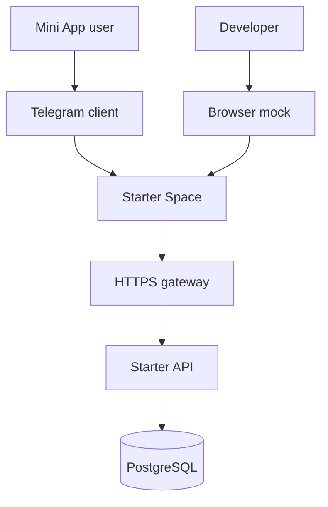
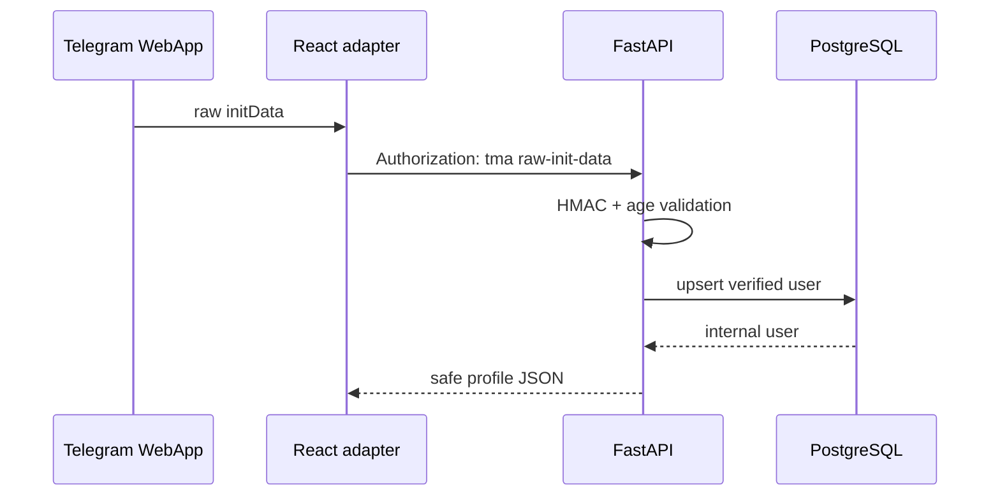
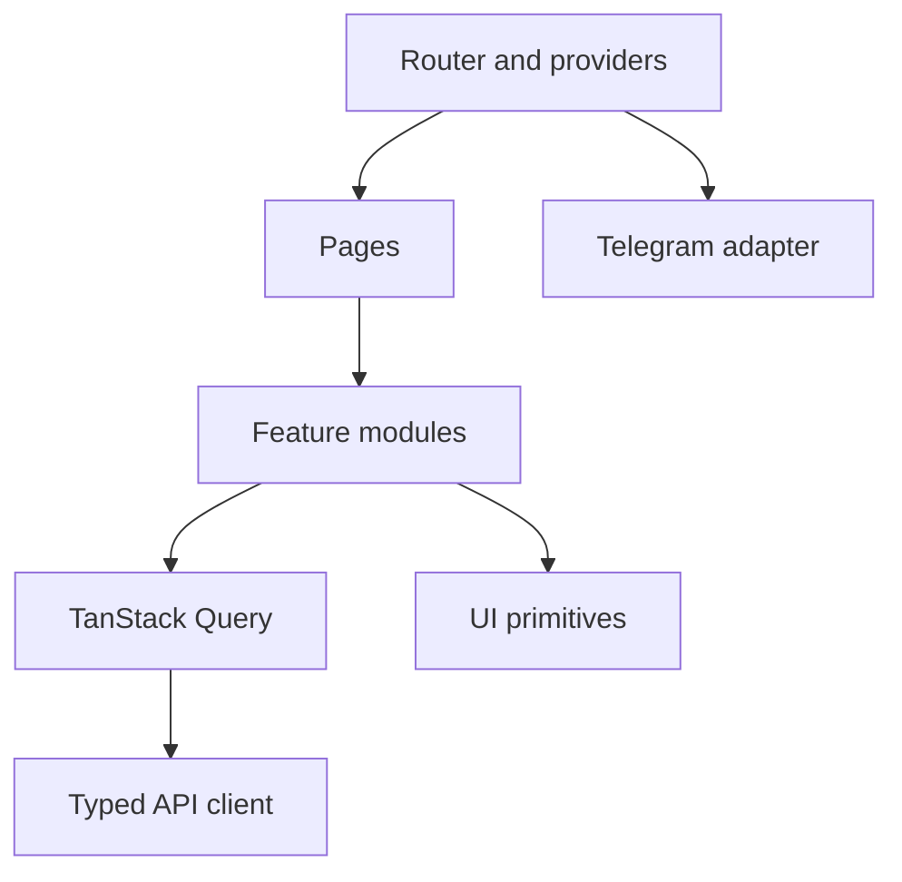
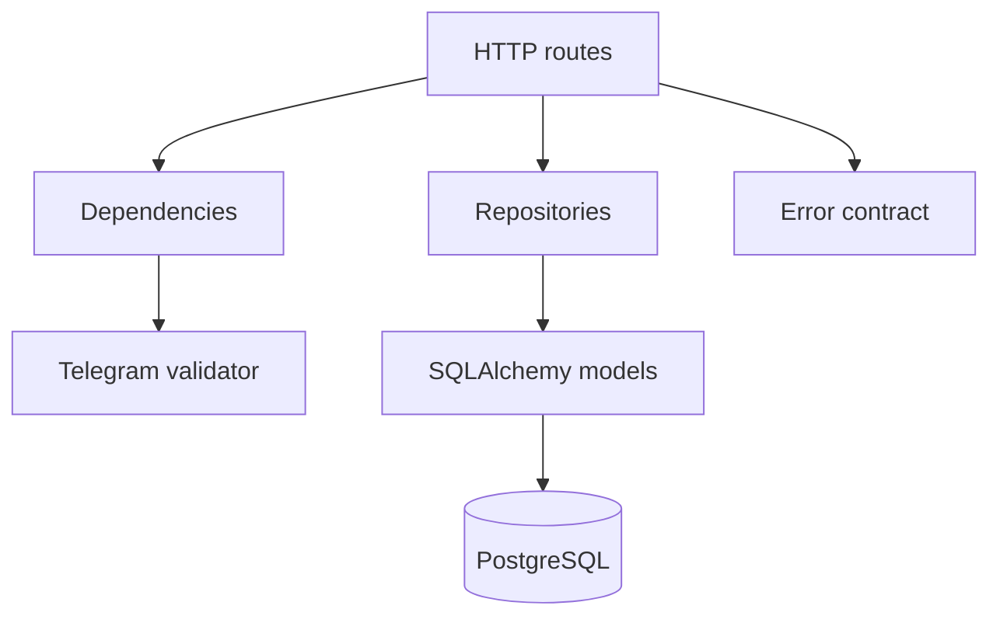
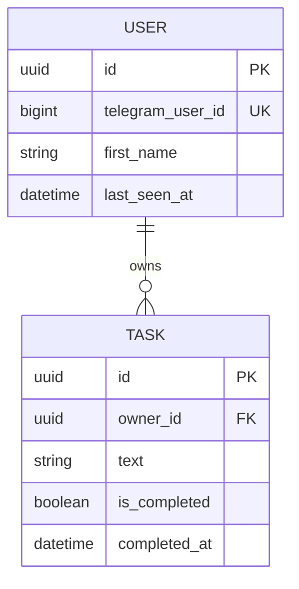
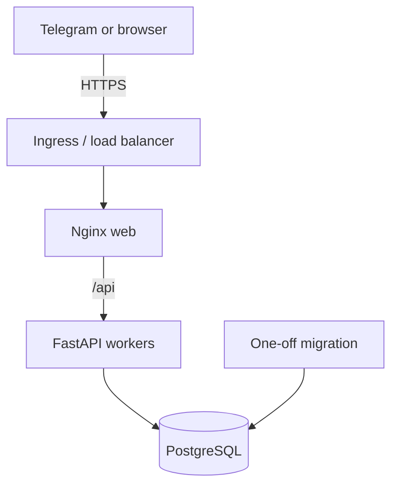

# Architecture

## System context

Telegram supplies launch data and host capabilities. Browser mock supplies explicit synthetic equivalents for development. Both render the same React feature modules; only the trusted authentication boundary differs.

## Containers

| Container   | Responsibility                                                         | Trust boundary     |
| ----------- | ---------------------------------------------------------------------- | ------------------ |
| Web / Nginx | Static assets, SPA fallback, same-origin API proxy, headers            | Public edge        |
| FastAPI     | Auth validation, user context, task rules, error and logging contracts | Application server |
| PostgreSQL  | Durable users and owner-scoped tasks                                   | Private network    |

## Authentication request sequence

`initDataUnsafe` may be shown as unverified launch context but never establishes identity. Protected routes resolve the user only from a successfully validated request or the separately guarded development header.

## Frontend module map

- `app/` owns providers, routing, route errors, and small UI state.
- `features/` owns auth and task behavior.
- `lib/api/` validates untrusted API responses with Zod and maps stable errors.
- `lib/telegram/` is the only module that touches the global Telegram bridge.
- `components/` owns reusable, accessible visual primitives and layout.
- `mocks/` is dynamically imported only by development code.

## Backend module map

Routes coordinate typed input and response models. Repositories contain explicit feature queries; the starter avoids a generic repository abstraction. Dependencies establish verified identity and mutation limits. Middleware owns correlation IDs and request logs without sensitive headers.

## Data model

Task lookups always combine task ID and authenticated owner ID. A request for another user's object receives the same not-found response as an unknown ID.

## Deployment topology

The repository provides the Nginx, application, and database layer. A downstream deployment owns DNS, TLS certificates, backups, secret storage, monitoring, and infrastructure redundancy.

## Key decisions

- Monorepo with pnpm and uv: [ADR 0001](docs/decisions/0001-monorepo-and-package-management.md).
- Official bridge behind a typed adapter: [ADR 0002](docs/decisions/0002-telegram-sdk-selection.md).
- Per-request raw init data validation: [ADR 0003](docs/decisions/0003-authentication-strategy.md).
- CSS Modules and semantic tokens: [ADR 0004](docs/decisions/0004-styling-and-design-tokens.md).
- PostgreSQL and explicit Alembic migrations: [ADR 0005](docs/decisions/0005-database-and-migrations.md).
- Risk-oriented test pyramid: [ADR 0006](docs/decisions/0006-testing-strategy.md).
- Same-origin Nginx deployment: [ADR 0007](docs/decisions/0007-deployment-model.md).

## Extension points

- Add feature routes and repositories without changing authentication.
- Generate frontend types from the committed OpenAPI schema if the API grows.
- Replace the process-local mutation limiter with Redis at multiple replicas.
- Add an external ingress, managed database, metrics, and error reporting.
- Extract the design primitives only after more than one product proves the API.

## Known trade-offs

- Raw init data is revalidated on protected requests. This avoids browser token storage and JWT complexity but adds small HMAC and user-upsert cost.
- The local mutation limiter is process-local and is not a distributed abuse-control guarantee.
- Task lists are bounded to 100 records rather than introducing pagination UI into the starter.
- Browser mock E2E cannot prove Telegram client transport, real theme values, or physical iOS/Android behavior.
- Production source maps are disabled by default to reduce accidental source disclosure.
