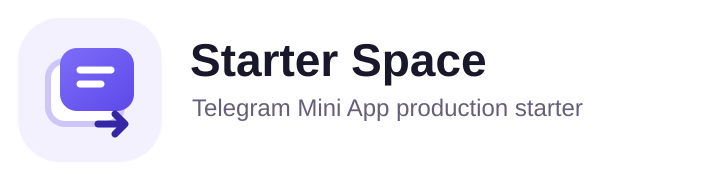
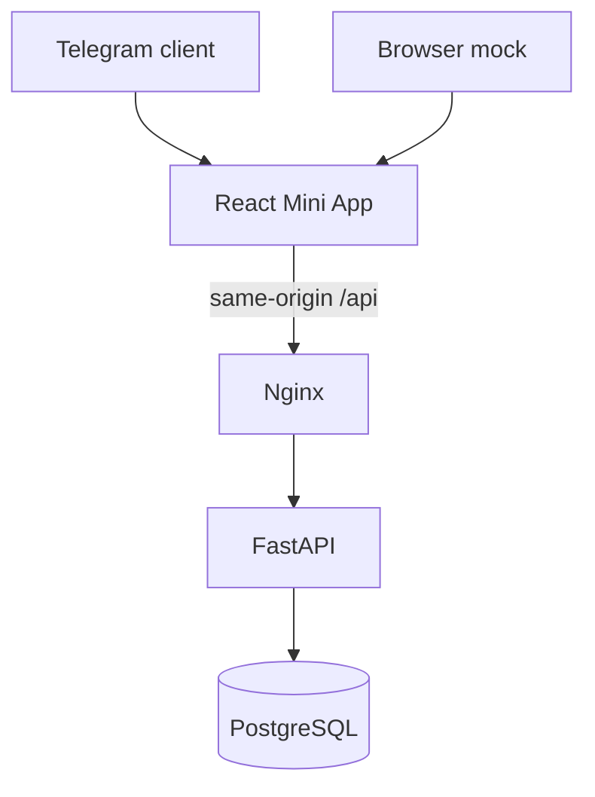

<p align="center">
  
</p>

# Telegram Mini App Production Starter

Production-oriented React and FastAPI foundation for Telegram Mini Apps with server-validated init data, PostgreSQL, Docker, automated tests, and an adaptive mobile interface.


> **Initial release status:** the repository packages a tested foundation for extension. It has not undergone an independent security audit and does not claim production adoption metrics.

## Preview

The Playwright visual suite creates sanitized, deterministic screenshots from browser mock mode. Generate the public set with `pnpm --filter @starter/web test:e2e:update` before the first public release. No unrelated product assets or private screenshots are used.

## Features

- React 19, Vite 8, strict TypeScript, React Router 8, TanStack Query, Zustand, Zod, and React Hook Form.
- Direct typed adapter over the official Telegram WebApp bridge: theme, viewport, safe areas, BackButton, MainButton, haptics, and closing confirmation.
- Explicit browser development mode with synthetic identity, deterministic tasks, theme controls, safe-area controls, and failure states.
- FastAPI with Pydantic, async SQLAlchemy, PostgreSQL, Alembic, structured logs, request IDs, and stable errors.
- Official HMAC-SHA-256 Telegram init data validation with constant-time comparison and configurable expiry.
- Backend user upsert and owner-scoped task create, list, edit, complete, and delete flows.
- Loading, skeleton, empty, error, offline, stale-safe optimistic, dialog, toast, and bottom-sheet patterns.
- Multi-stage containers, development and production Compose files, and an Nginx same-origin reverse proxy.
- Ruff, mypy, pytest, Vitest, Testing Library, Playwright, CodeQL, Dependabot, and GitHub Actions.

## Architecture

The browser receives raw `Telegram.WebApp.initData` and forwards it on protected requests as `Authorization: tma <initData>`. The API verifies the signature and age before deriving a user. Raw init data and bot tokens are never stored in browser storage.



See [ARCHITECTURE.md](ARCHITECTURE.md) for module, data, request, and deployment diagrams.

## Prerequisites

- Node.js 24.14 or newer in the Node 24 line.
- Corepack and pnpm 11.18.
- Python 3.12 and uv 0.11 for API development.
- Docker Engine with Compose v2 for the full stack.

Pinned runtimes are recorded in `.nvmrc`, `.python-version`, lockfiles, and Dockerfiles.

## Quick start: browser mock

No Telegram bot token, database, or Docker is required.

```bash
corepack enable
pnpm install --frozen-lockfile
pnpm --filter @starter/web dev
```

Open <http://localhost:5173>. The visible **Browser mock** badge confirms that the identity and Telegram surface are synthetic. The mock route cannot become the production authentication path because it is guarded by Vite's compile-time development flag and a production bundle check.

## Quick start: full stack

```bash
cp .env.example .env
docker compose up -d db
docker compose run --rm api alembic -c alembic.ini upgrade head
docker compose up --build
```

Open <http://localhost:5173>. Browser mock identity is explicit, while task CRUD is persisted through FastAPI and PostgreSQL because Compose sets `VITE_API_MODE=http`.

## Telegram bot setup

1. Create or select a bot using the verified BotFather account in Telegram.
2. Copy `.env.example` to `.env` and set `TELEGRAM_BOT_TOKEN` locally. Never commit it.
3. Deploy the web gateway behind HTTPS.
4. Configure the Mini App or Menu Button URL to the HTTPS origin.
5. Launch from Telegram and confirm the profile says **Verified by backend**.

Read the complete [Telegram setup guide](docs/guides/telegram-bot-setup.md). The starter does not create a bot, configure BotFather, or deploy a domain automatically.

## Environment configuration

Root `.env.example` is Compose-oriented. App-specific examples live in `apps/api/.env.example` and `apps/web/.env.example`. Every supported variable, requirement, default, and secrecy classification is in the [environment variable reference](docs/reference/environment-variables.md).

Production startup fails when the bot token is absent, mock authentication is enabled, debug mode is enabled, SQLite is selected, or non-JSON logging is selected.

## Common commands

| Command                 | Purpose                                                |
| ----------------------- | ------------------------------------------------------ |
| `make setup`            | Install locked web and API dependencies                |
| `make dev-web`          | Start the standalone browser mock UI                   |
| `make dev-api`          | Start FastAPI with reload                              |
| `make db-up`            | Start PostgreSQL through Compose                       |
| `make migrate`          | Apply Alembic migrations using the current environment |
| `make check`            | Run lint, types, and unit tests                        |
| `make test-e2e`         | Run Playwright browser scenarios                       |
| `make api-schema-check` | Detect committed OpenAPI drift                         |
| `make docker-build`     | Build images and validate Compose                      |
| `make verify`           | Run the complete pre-release verification gate         |

Windows users can run the underlying pnpm and uv commands from PowerShell; see [Quick start](docs/guides/quick-start.md).

## Project structure

```text
apps/web/          React Mini App, browser mock, unit tests, Playwright
apps/api/          FastAPI, Telegram validation, models, Alembic, pytest
infra/nginx/       Same-origin proxy and reviewed security headers
docs/              Architecture decisions, guides, operations, references
scripts/           Schema export, seed, scans, archive and docs checks
.github/           CI, CodeQL, Dependabot, issue and PR templates
```

## Testing

```bash
make check
make test-e2e
make docker-build
```

The highest-risk boundaries receive focused coverage: Telegram signature validation, production mock guards, object ownership, typed API response validation, modal focus, BackButton behavior, task flows, responsive widths, and migration-to-head. See the [testing guide](docs/guides/testing.md).

## Deployment overview

The production example serves built frontend assets from Nginx, proxies `/api` to FastAPI, runs PostgreSQL on an internal network, and applies migrations as an explicit one-off step. Supply a real HTTPS ingress or load balancer; the repository intentionally does not guess a certificate provider or domain.

- [Docker Compose deployment](docs/deployment/docker-compose.md)
- [Nginx and HTTPS](docs/deployment/nginx.md)
- [Production checklist](docs/deployment/production-checklist.md)

## Security

This is a production-oriented baseline, not a universal security guarantee. Review [SECURITY.md](SECURITY.md) and the [threat model](docs/reference/threat-model.md) before adapting authentication, adding personal data, or exposing new endpoints. Enable GitHub private vulnerability reporting after publication.

## Documentation

- [Why this project](WHY_THIS_PROJECT.md)
- [Architecture](ARCHITECTURE.md)
- [Browser mock mode](docs/guides/browser-mock-mode.md)
- [Theming and safe areas](docs/guides/theming.md)
- [Adding a feature](docs/guides/adding-a-feature.md)
- [API reference](docs/reference/api.md)
- [Dependency license review](docs/reference/dependency-licenses.md)
- [Troubleshooting](docs/reference/troubleshooting.md)
- [Maintainer guide](docs/maintainer-guide.md)

## Contributing

Read [CONTRIBUTING.md](CONTRIBUTING.md) before a large change. Security reports do not belong in public issues; follow [SECURITY.md](SECURITY.md).

## Roadmap

v0.1.0 intentionally omits payments, queues, Redis, analytics SaaS, and product business logic. See [ROADMAP.md](ROADMAP.md) for considered extensions without promised dates.

## License

[MIT](LICENSE). The original project mark and UI are included under the same repository license.

## Non-affiliation

This independent open-source project is not affiliated with, endorsed by, or sponsored by Telegram or OpenAI. Telegram is a trademark of its respective owner.
